<p align="center">
  
</p>

<p align="center">
  <a href="https://github.com/hemanthsai123"></a>
  
</p>

## Market board

Refreshed by a scheduled GitHub Action on weekdays (see [How it stays live](#how-it-stays-live)).



## What is moving



## Screeners



## AI market agent



## What is in this repo

| Part | What it does |
|---|---|
| [`screener/`](./screener) | Scans 49 large NSE stocks for 52-week highs, volume shockers and RSI/EMA momentum |
| [`agent/`](./agent) | Reads the market data and writes a short brief; can use a local Ollama model |
| [`scripts/`](./scripts) | Fetches indices and draws every SVG on this page |
| [`.github/workflows/`](./.github/workflows) | The schedule that keeps it all fresh |

## Stack

`Python` · `pandas` · `yfinance` · `Ollama` · `GitHub Actions` · `SVG`

## How it stays live

GitHub READMEs cannot run JavaScript, so "live" here means a bot re-draws the SVGs and commits them.

```
.github/workflows/refresh.yml   every 30 min on weekdays, 08:30–16:00 IST
  scripts/fetch_market.py       Nifty, Bank Nifty, India VIX + 7-session sparkline (yfinance, delayed)
  screener/screener.py          52-week highs · volume shockers · momentum → data/screens_live.json
  agent/market_agent.py         facts → brief (rules engine; USE_LLM=1 adds Ollama llama3.2)
  scripts/build_visuals.py      data/*.json → assets/*.svg (stdlib only)
```

Sector rotation and breadth come from NSE end-of-day files, so they update after the close, not intraday.
The committed snapshot is the **29 Oct 2026 close**.

Run locally:

```bash
pip install -r requirements.txt
python screener/screener.py --demo   # no network
python agent/market_agent.py
python scripts/build_visuals.py
```

> Educational use only. Nothing here is investment advice.
